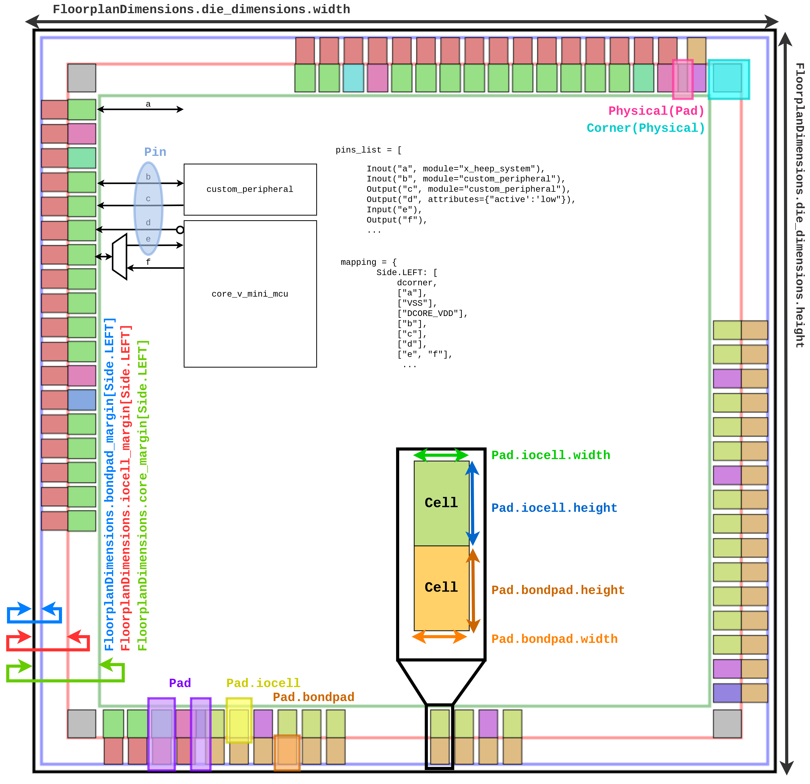

# Pad Configuration

The pads of the design are configured with a Python configuration file, read by `mcu-gen` and by the template files to generate the pad ring RTL (`hw/ip/pad_ring/pad_ring.sv`), the pad control registers and the pad connections of the `x_alp` top level (`hw/x_alp.sv`). X-ALP uses the same pad generator as X-HEEP.

## Overview

The pad configuration system allows you to define:
- Pins (signals): the logical signals of your design (e.g., `clk`, `uart_tx`). Optionally, also analog and supply signals.
- Pin-to-pad mapping: how pins are assigned to physical pads on each side of the chip, including multiplexing (multiple pins on the same pad).
- (Optional) Floorplan: physical layout of the die and location of the pads.

The configuration is done through a Python `config(xheep)` function that takes the system object as its only argument and returns a `PadRing` object. This allows the pad configuration to depend on the current system configuration. The default pad configuration file is `configs/pad_cfg.py`.

The default call to `mcu-gen` uses the default pad configuration, but you can specify a custom one with the `PADS_CFG` variable:

```bash
make mcu-gen PADS_CFG=configs/my_pad_cfg.py
```

## Default pins

The default configuration defines the following pins, all on the top side:

| Pin | Direction | Module |
|-----|-----------|--------|
| `clk` | input | `core_v_mcu` |
| `rst` | input, active low | `x_alp` |
| `jtag_tck`, `jtag_tms`, `jtag_tdi` | input | `core_v_mcu` |
| `jtag_trst` | input, active low | `core_v_mcu` |
| `jtag_tdo`, `jtag_tdo_oe` | output | `core_v_mcu` |
| `uart_rx` | input | `core_v_mcu` |
| `uart_tx` | output | `core_v_mcu` |
| `exit_valid` | output | `core_v_mcu` |

## Pin types

Pins represent the signals of your design. The digital pin types are:

```python
from pads.pin import Input, Output, Inout

clk_pin = Input("clk", module="core_v_mcu")     # Input pin
tx_pin = Output("uart_tx", module="core_v_mcu") # Output pin
gpio_pin = Inout("gpio_0", module="core_v_mcu") # Bidirectional pin
```

Other pin types can be defined, including for analog signals and power supply. See the [X-pert Zone](#x-pert-zone) section below.

## Pin attributes

Pins can have additional attributes that modify their behavior:

- The `module` attribute specifies which module of the design the pin is connected to. In X-ALP, use `module="core_v_mcu"` for the signals of the `core_v_mcu` module (`hw/system/core_v_mcu.sv`) and `module="x_alp"` for the signals that stay in the `x_alp` top level (e.g. the reset).

```{warning}
The default value of `module` is `"core_v_mini_mcu"`, inherited from X-HEEP. It does not exist in X-ALP, so always set `module` explicitly.
```

- The `attributes` dictionary can include custom key-value pairs. Predefined attributes include:
  - `active`: if set to `"low"`, the pin is active low and gets an `_n` suffix in the generated RTL.
  - `priority`: the priority of the pin when multiple pins are multiplexed on the same pad. The pin with the highest priority is the default one, and the pad takes its name.

```python
# Active-low signal
rst = Input("rst", module="x_alp", attributes={"active": "low"})

# Priority for multiplexed pads
gpio = Inout("gpio_0", module="core_v_mcu", attributes={"priority": 1})
spi = Inout("spi_mosi", module="core_v_mcu", attributes={"priority": 2})  # This will be the default
```

## Creating pin lists

For convenience, you can create pin lists programmatically and convert them to a dictionary:

```python
digital_pins = [
    Input("clk", module="core_v_mcu"),
    Input("rst", module="x_alp", attributes={"active": "low"}),
    Input("uart_rx", module="core_v_mcu"),
    Output("uart_tx", module="core_v_mcu"),
]

pin_dict = {}
for pin in digital_pins:
    pin_dict.update({pin.name: pin})
```

```{note}
Adding a pin to the pad configuration does not add the corresponding port to the RTL. A new pin needs a matching port in the module it is connected to (e.g. in `hw/system/core_v_mcu.sv.tpl`).
```

## Pin-to-pad mapping

The mapping defines which pins are assigned to pads on each side of the chip, selected by their names:

```python
from pads.floorplan import Side

mapping = {
    Side.TOP: [
        ["clk"],               # Single pin on one pad
        ["rst"],
        ["uart_tx"],
        ["spi_sck", "gpio_14"],  # Multiplexed pad: spi_sck OR gpio_14
    ],
    Side.BOTTOM: [
        ["uart_rx"],
    ],
}

# Replace the names with the corresponding Pin objects
mapping = {
    side: [[pin_dict[p] for p in group] for group in groups]
    for side, groups in mapping.items()
}
```

If you are only simulating, you can assign all pins to one side (e.g., `Side.TOP`) without worrying about the physical layout, as the default configuration does.

## Floorplan dimensions (optional)

For ASIC implementations, you can specify the physical dimensions. See the diagram in the [Visualization](#visualization-optional) section below for their meaning.

```python
from pads.floorplan import FloorplanDimensions
from pads.dimension import Dimension

floorplan = FloorplanDimensions(
    die_dimensions=Dimension(width=5000, height=5000),  # in micrometers
    bondpad_margin={Side.LEFT: 100, Side.BOTTOM: 100, Side.RIGHT: 100, Side.TOP: 100},
    iocell_margin={Side.LEFT: 150, Side.BOTTOM: 150, Side.RIGHT: 150, Side.TOP: 150},
    core_margin={Side.LEFT: 200, Side.BOTTOM: 200, Side.RIGHT: 200, Side.TOP: 200},
)
```

## Building the PadRing

Once pins and mapping are defined, create the PadRing:

```python
from pads.pad_ring import PadRing

def config(xheep) -> PadRing:
    # ... define pins and mapping ...

    padring = PadRing(
        floorplan_dimensions=None,  # or a FloorplanDimensions object
        pin_list=list(pin_dict.values()),
        mapping=mapping,
        attributes={},
    )

    # Print a summary of the pins attached to each pad
    padring.print_pin_summary()

    return padring
```

## Visualization (optional)

For designs with floorplan dimensions, you can generate visual representations:

```python
from pads.graphic import generate_floorplan_visuals

generate_floorplan_visuals(floorplan, padring, filename_base="my_floorplan")
```

This generates:
- `my_floorplan.svg`: a static floorplan image;
- `my_floorplan.html`: an interactive floorplan with hover tooltips.


_Example of a generated diagram, with the floorplan dimensions added on top._

<!-- MyST's cross-reference for the docs -->
(x-pert-zone)=
## 😎 X-pert Zone (mostly for ASIC implementation)

### Custom pad attributes

You can add custom attributes to the PadRing for technology-specific features. They are accessible in the template files during RTL generation. The following predefined attributes are used for the pad control generation:

- `bits`: bit range that defines the width of the pad attribute field (e.g., `"7:0"` or `"3:0"`).
- `resval`: reset value of the pad attribute register. It must fit in the width defined by `bits`.
- `constant_attribute`: per-pad attribute (set on a pin attributes dictionary) that, when `True`, fixes the pad attribute to `resval` and omits the writable register for that pad.

```python
padring = PadRing(
    floorplan_dimensions=None,
    pin_list=list(pin_dict.values()),
    mapping=mapping,
    attributes={
        "bits": "3:0",
        "resval": 0x5,
    },
)

# Per-pin attribute to lock the pad attribute
gpio = Inout("gpio_0", module="core_v_mcu", attributes={"constant_attribute": True})
```

### Custom pad ring RTL

You can add custom RTL code to the pad ring with the `custom_rtl` argument of the PadRing:

```python
padring = PadRing(
    floorplan_dimensions=None,
    pin_list=list(pin_dict.values()),
    mapping=mapping,
    custom_rtl="""
        logic custom_signal;
        assign custom_signal = 1'b0;
    """,
)
```

### Spacing pads by pitch

For precise physical placement:

```python
padring.space_side_by_pitch(
    side=Side.TOP,
    space_from_corner_cell=100.0,  # µm from corner
    pitch=50.0,  # µm between pads
)
```

You can also space any pad from the edge by forcing its `iocell_center_to_ring_edge` attribute:

```python
padring.pad_list[31].iocell_center_to_ring_edge = 1000
```

### Custom pad cells

You can define the pad cells of your PDK with the `Cell` class, or update the default ones defined in `util/xheep_gen/pads/cell.py` (`iocell_d`, `iocell_a`, `bondpad_d`, `bondpad_a`):

```python
from pads.cell import Cell, iocell_a
from pads.dimension import Dimension

# Update a default cell
iocell_a.update(dimension=Dimension(width=60, height=65), name="PADIOA")
# Create a custom cell as defined by the PDK
iocell_dVdd = Cell(width=65, height=65, name="PADVDDIO", rtl_wrapper="pad_cell_digital_core_vdd", connections=["vdd"])
```

For new cells, also create an RTL wrapper with a consistent name. To assign custom cells to custom pin types, see the [X-HEEP pad configuration guide](https://x-heep.readthedocs.io/en/latest/Configuration/PadConfiguration.html).
